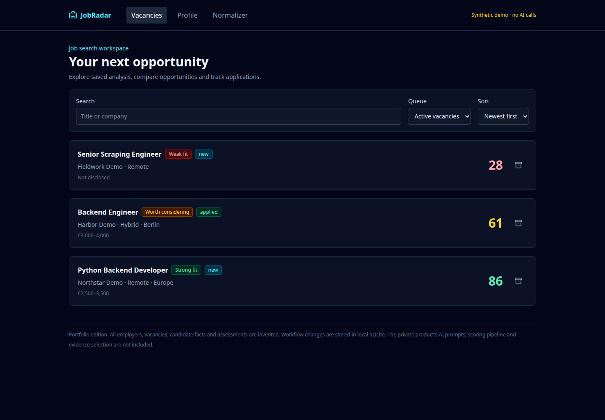

# JobRadar Showcase

A runnable portfolio edition of **JobRadar**, a private job-search assistant.
Explore vacancy analysis, review candidate evidence and track application status.
This repository publishes selected implementation examples and a synthetic demo;
the full AI analysis product remains private.



## Run with one command

Requires Docker with Compose. No API keys, account or paid services are needed.

```sh
git clone https://github.com/wizuratcom/jobradar-showcase.git
cd jobradar-showcase
docker compose up --build
```

Open **http://localhost:8080**. REST documentation: **http://localhost:8080/docs**.
The first build downloads dependencies. Stop with `docker compose down`.
Workflow data is saved in a named Docker volume across restarts.

## Try it

- Search the three example vacancies and sort by newest or fit score.
- Open a vacancy to compare strengths, risks and unverified profile factors.
- Change application status, archive an applied vacancy, then restore it.
  Its previous status is restored and persists after refresh.
- Inspect the fictional candidate profile, skills, languages and project.
- Use the source normalizer to convert HTML/entity-encoded text through the API.

## What is real, what is simulated

**Working implementation:** React/TypeScript UI, responsive Tailwind components,
REST requests, error/loading states, search/filter/sort, SQLite persistence,
status transitions, archive/restore, Pydantic validation and source normalization.

**Simulated:** vacancy fit assessments are pre-authored fixtures. Every company,
vacancy, profile and result is invented. No AI model is called, and scores are
not calculated for new input. This edition has no authentication or live URL
import. It binds to localhost and is intended for local evaluation.

**Private:** production prompts, candidate context selection, evidence grounding,
live extraction/fit analysis, full database and authenticated product workflows.
G0 in the private product imports/structures; G1 assesses fit; G2 assists with
applications; G3 prepares interviews. This demo illustrates saved G1 results.

## Repository layout

```text
backend/normalization.py  Selected utility adapted from the private backend
backend/app.py            Demo REST service and SQLite workflow
backend/fixtures.py       Synthetic scenario data
backend/test_demo.py      API and normalizer regressions
web/src/main.tsx          Independent React showcase application
web/src/ui.tsx            UI primitives reused from JobRadar
Dockerfile                Multi-stage web build + Python runtime
.github/workflows/        Automated verification
```

The demo is deliberately independent from the private API. It uses a small public
contract and can be cloned and run without access to either private repository.

## Development and tests

Python 3.12+ and Node 22:

```sh
python -m venv .venv
. .venv/bin/activate
pip install -r backend/requirements.txt pytest pytest-asyncio httpx ruff
python -m pytest backend -q
ruff check backend --ignore E501
uvicorn backend.app:app --port 8080
```

In another terminal:

```sh
cd web
npm ci
npm run lint
npm run build
npm run dev
```

Vite proxies `/api` to localhost:8080. Container deployment serves the built UI
and API from the same origin. The SQLite database path is configurable through
`DEMO_DB_PATH`; defaults to `data/demo.db`.

## Publication scope

Only the code in this repository is public. No private repository history,
credentials, production database, real CVs or real employer texts are included.
This project demonstrates selected engineering and UX work rather than
distributing the entire JobRadar application.

The public showcase code is MIT-licensed. This license covers only this
repository, not the private product or its implementation.

Optional browser regression against the running demo:

```sh
pip install playwright
playwright install chromium
python -m backend.smoke_browser
```
